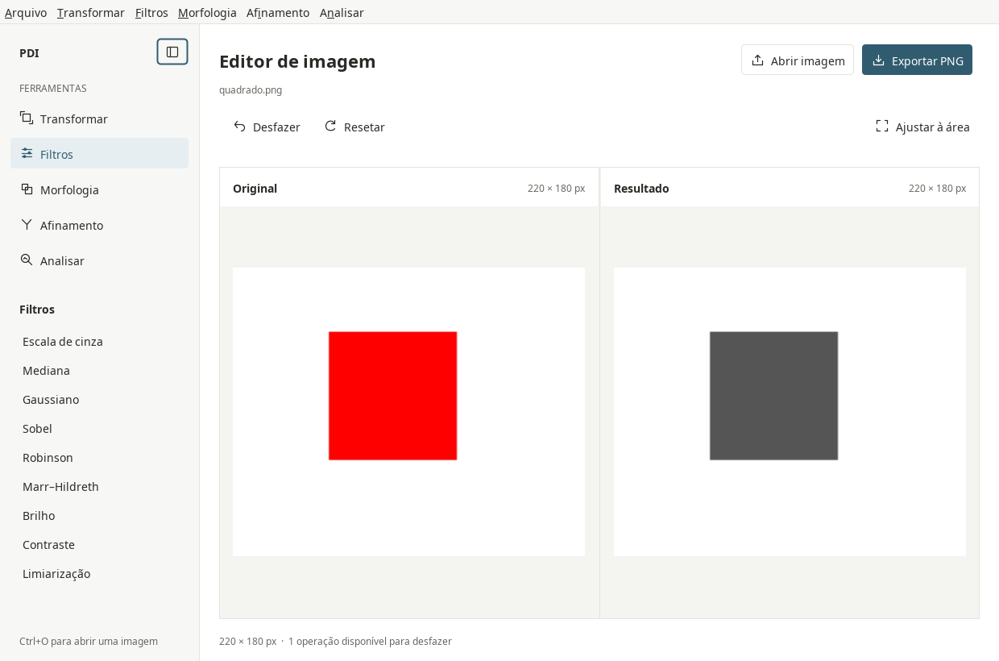

# Processamento Digital de Imagens

Aplicação desktop Java para experimentar transformações, filtros e reconhecimento por visão computacional clássica. O projeto reúne algoritmos próprios e OpenCV em um fluxo de carregar, processar, comparar e exportar imagens.



## Funcionalidades

- Rotação, translação, espelhamento e escala por matrizes homogêneas.
- Escala de cinza pela média dos canais, brilho, contraste e limiarização.
- Mediana, Gaussiano, Sobel, Robinson e Marr–Hildreth.
- Dilatação, erosão, abertura, fechamento e afinamento Zhang–Suen.
- Contagem de formas coloridas por segmentação HSV e componentes conexos.
- Reconhecimento de letras maiúsculas A–Z por comparação com templates.
- Leitura de relógios analógicos, análise de gráficos de barras e identificação heurística de placas de trânsito.
- Comparação original/resultado, arrastar arquivos, histórico limitado, reset e exportação PNG.

Os reconhecedores são experimentos educacionais com condições de entrada restritas. Resultados desconhecidos ou incompletos são indicados explicitamente. Não há modelos treinados, LLMs, chamadas a APIs nem serviços pagos.

## Instalação e execução

Requisitos: **JDK 17 ou 21**, conexão com Maven Central na primeira execução e um ambiente gráfico para a interface. Não é necessário instalar Maven ou OpenCV separadamente: o Maven Wrapper fixa Maven 3.9.9, e a dependência `org.openpnp:opencv:4.9.0-0` fornece os bindings e bibliotecas nativas correspondentes. O primeiro download do OpenCV tem cerca de 110 MB.

```bash
./mvnw verify
./mvnw compile exec:java
```

No Windows, use `mvnw.cmd` nos mesmos comandos. Linux x86-64 com JDK 21 foi validado neste ambiente; a CI está configurada para Linux com Java 17 e 21. Outras plataformas dependem de biblioteca nativa compatível com a distribuição OpenCV e ainda precisam de validação. Um display é necessário para abrir a janela; a ausência de display não impede os testes headless.

Para executar o pacote fora do Maven, após `./mvnw package`:

```bash
# Linux/macOS; no Windows, o separador de classpath é ;
java -cp 'target/pdi-1.7.0-SNAPSHOT.jar:target/dependency/*' src.Painel
```

O carregamento nativo é sob demanda. Se a plataforma não for suportada, a interface informa o erro ao tentar a análise; os filtros Java continuam disponíveis. Não forneça manualmente uma biblioteca de versão diferente.

### Ambiente de nuvem

O ambiente preparado usa JDK e caches em `/workspace/pdi-environment`. O helper `/workspace/pdi-environment/mvn-pdi` configura o proxy e o cache Maven locais; ele não faz parte do produto. As instruções de inicialização salvas no ambiente informam como ativá-lo. Segredos e configurações de proxy não devem ser commitados.

## Demonstração

1. Abra `examples/quadrado-vermelho.png` e aplique **Filtros → Escala de cinza**.
2. Use **Desfazer** e **Resetar**. Exporte o resultado por **Exportar PNG**.
3. Abra os exemplos abaixo e escolha o exercício correspondente.

| Arquivo | Exercício | Resultado esperado |
|---|---|---|
| `examples/formas.png` | Contar objetos | Um quadrado vermelho, um círculo amarelo, um retângulo verde e um triângulo azul |
| `examples/letras.png` | Reconhecer letras | `A, B, C, D` |
| `examples/relogio-3.png` | Ler relógio | `03:00` |
| `examples/relogio-6.png` | Ler relógio | `06:00` |
| `examples/barras.png` | Analisar barras | `Maior = 20 \| Menor = 10` |
| `examples/barras-sem-escala.png` | Analisar barras | Valores indeterminados; não assume zero |
| `examples/pare.png` | Identificar placas | `Pare` — candidato octogonal sintético |
| `examples/quadrado-preto.png` | Reconhecer letras | `?` — glifo não reconhecido |
| `examples/quadrado-vermelho.png` | Identificar placas | `Placa desconhecida` |

As imagens são sintéticas e geradas pelo próprio projeto. Para regenerá-las:

```bash
./mvnw compile exec:java -Dexec.mainClass=src.demo.GenerateExamples
```

Os resultados desses exemplos são verificados por `ExamplesTest`. Eles não representam uma avaliação de precisão em fotografias reais.

## Interface e navegação

A área de trabalho usa uma barra lateral com cinco categorias: Transformar, Filtros, Morfologia, Afinamento e Analisar. As mesmas 23 ferramentas continuam disponíveis nos menus. Os exercícios sem parâmetros executam diretamente e exibem o resultado na área de trabalho, onde o texto pode ser selecionado e copiado.

- **Abrir imagem** e **Exportar PNG** ficam no cabeçalho.
- **Desfazer** e **Resetar** ficam junto à comparação.
- A lateral recolhe automaticamente abaixo de 1020 px; os ícones abrem os grupos de ferramentas. Também é possível recolher ou expandir manualmente.
- A comparação se adapta à área útil: lado a lado em janelas largas ou baixas; empilhada quando a área é estreita e há altura suficiente.
- **Ajustar à área** alterna para **Tamanho real · 100%**, com rolagem, sem alterar os pixels da imagem.
- Parâmetros são validados no próprio formulário. Enter aplica, Esc ou Cancelar fecha sem aplicar.
- Resultados, erros e confirmação de exportação aparecem em um painel discreto abaixo da comparação; Esc o fecha.

| Atalho | Ação |
|---|---|
| Ctrl+O | Abrir imagem |
| Ctrl+S | Exportar PNG |
| Ctrl+Z | Desfazer |
| Ctrl+Shift+R | Resetar |
| Ctrl+B | Recolher/expandir ferramentas |
| Ctrl+0 | Ajustar imagem à área |
| F1 | Sobre o projeto |

No macOS, os atalhos usam Cmd. A navegação com Tab, os menus com Alt no desktop e os controles padrão de sliders/seletores foram preservados. O [design system](docs/design-system.md) documenta tokens, componentes, decisões e limites da validação.

## Testes e CI

```bash
# Processamento, sessão, arquivos, reconhecedores, recursos nativos e exemplos
./mvnw verify

# Também abre e opera a janela; requer display
./mvnw -Pdesktop verify

# Linux sem monitor, com Xvfb e xauth instalados
xvfb-run -a ./mvnw -Pdesktop verify
```

O perfil padrão é headless e omite os testes que abrem janelas. O perfil `desktop` também valida a edição, navegação, parâmetros, teclado, arrastar arquivos e comportamento responsivo. Os relatórios ficam em `target/surefire-reports/`.

A [CI](.github/workflows/ci.yml) executa build e testes com Java 17/21 e o teste desktop com Xvfb em Java 21. A configuração de CI não comprova uma execução remota bem-sucedida; consulte os resultados do GitHub Actions.

## Arquitetura e decisões

| Componente | Responsabilidade |
|---|---|
| `src.Painel` | Interface Swing, catálogo de ações compartilhadas e coordenação de um único `SwingWorker` por vez |
| `ui` | Tokens visuais, botões, navegação, formulários, diálogos e visualização de imagem |
| `core.EditorSession` | Original, resultado, histórico e alterações atômicas de estado |
| `core.AnalysisResult` | Estado tipado: identificado, inconclusivo ou não encontrado; resumo e detalhes |
| `filtros`, `transformacoes`, `morfologia`, `afinamento` | Algoritmos independentes da interface |
| `desafio` | Pipelines e regras dos cinco exercícios |
| `infra.ImageFiles` | Validação antes de decodificar e gravação PNG com arquivo temporário |
| `infra.OpenCvRuntime`, `infra.CvScope` | Carregamento nativo e liberação de matrizes temporárias |

- Java e Swing foram mantidos. O pacote-base `src` preserva a identidade das classes existentes.
- Os `.class` e fontes duplicados foram retirados; a versão completa é a referência, e o histórico Git conserva as anteriores.
- Saídas de filtros são RGB/ARGB para evitar quantização entre escritas de canais em imagens cinza/indexadas. O alfa é preservado; operações intencionalmente binárias, como afinamento, produzem imagem opaca.
- Rotação usa o centro dos pixels `(dimensão - 1) / 2`; transformações usam vizinho mais próximo. A interpolação bilinear da interface afeta apenas a visualização.
- Filtros de mediana/Gaussiano replicam a borda. Morfologia preserva a borda; Sobel/Robinson deixam o contorno externo preto. Essas políticas foram mantidas e não são intercambiáveis.
- A similaridade de glifos usa IoU do primeiro plano, evitando que margens vazias inflem o resultado. Os limiares de aceitação são heurísticos, não probabilidades calibradas.
- Arquivos de entrada têm limite de 64 MiB e imagens de 16 milhões de pixels. O histórico guarda até 20 estados e 128 MB de pixels. Os limites não constituem garantia contra todo esgotamento de memória em decodificadores.
- Operações trabalham sobre uma cópia, e o histórico só muda após sucesso. Processamento e arquivos rodam em segundo plano, com ações concorrentes bloqueadas.

Mais detalhes: [arquitetura e manutenção](docs/architecture.md) e [validação e limitações](docs/validation.md).

## Limitações e evolução futura

Os exercícios pressupõem imagens simples: objetos separados nas quatro cores suportadas; letras escuras sobre fundo claro e próximas da fonte dos templates; relógio com ponteiros distinguíveis; barras verticais com base comum e rótulos ou escala legíveis. Classificação de placas continua heurística: não lê o valor de velocidade nem oferece reconhecimento geral de sinais.

Não há benchmark com imagens reais, garantia de generalização, métricas de cobertura ou comparação de desempenho. Casos difíceis podem continuar produzindo falsos positivos ou negativos. Testes sintéticos e correções de regressão não eliminam essa limitação.

Evoluções **não implementadas**: avaliação com conjuntos externos rotulados, parâmetros calibrados por resolução, automação em lote, API/exportação de análises e comparação com modelos de aprendizado. Um assistente com LLM exigiria proposta e autorização próprias; não foi incluído nesta refatoração.
