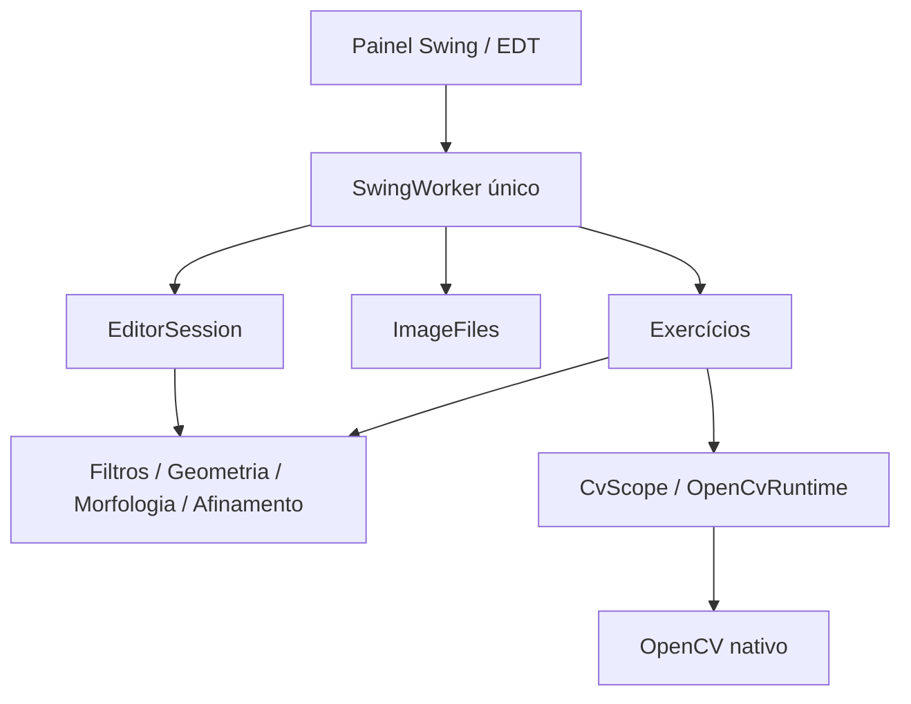

# Arquitetura e manutenção

## Estado e concorrência

`EditorSession` possui as imagens e não permite que uma operação que falhe altere a imagem anterior: a função recebe uma cópia e só depois do retorno válido são atualizados histórico e resultado. Os getters entregam referências somente para leitura. Não são APIs para modificar pixels diretamente.

A janela coordena uma tarefa por vez. Ela desabilita ações, executa processamento/arquivos no worker e atualiza a apresentação no EDT. Ao carregar uma imagem inválida, a sessão anterior permanece disponível. O histórico é limitado por quantidade e estimativa de memória; desfazer além dos estados retidos não é possível. Abrir outra imagem e resetar limpam o histórico.

## Imagens e arquivos

`Images` centraliza orçamento de pixels, cópia e alocação RGB/ARGB. Essa representação elimina o efeito de converter e quantizar uma imagem grayscale a cada escrita de canal. O grayscale mantém a média aritmética RGB original do projeto.

`ImageFiles` consulta o cabeçalho com `ImageReader` antes da decodificação. A gravação usa um temporário no mesmo diretório; só substitui o destino depois da codificação completa. O fallback para arquivos sem suporte a movimento atômico usa `Files.move` normal. O usuário continua responsável por selecionar o destino.

## OpenCV

Os bindings e a biblioteca nativa vêm da mesma dependência OpenPnP fixada no `pom.xml`. A aplicação não combina o JAR com um OpenCV do sistema. A versão usada nesta refatoração é 4.9.0; a análise inicial utilizou temporariamente 4.10.0. Os testes finais usam exclusivamente a versão declarada no build.

Cada `evaluate` abre um `CvScope`, que registra matrizes temporárias das funções auxiliares e as libera em ordem inversa, inclusive sob exceção. O contexto é local à thread e não deve atravessar tarefas assíncronas. As análises retornam dados Java, nunca matrizes nativas.

Templates são armazenados como bytes no heap Java; não guardam `Mat` depois de fechar o escopo. Ao adicionar chamadas OpenCV que criam matrizes (incluindo clones, ROIs, contornos e canais), registre-as no escopo. Chamadores de helpers nativos de baixo nível fora de `evaluate` devem abrir um escopo ou liberar explicitamente os objetos retornados e temporários.

## Reconhecedores e compatibilidade

`evaluate(BufferedImage)` fornece `AnalysisResult`: status, resumo e detalhes. Métodos antigos que retornam strings (`contar`, `reconhecer`, `identificar`, `analisar`, `lerHorario`) continuam disponíveis como adaptadores. A interface usa o resultado tipado, sem inferir status a partir da mensagem.

A IoU de glifos compara pixels de primeiro plano. Os limiares atuais (letras 0,70; dígitos 0,55) atendem às regressões e fixtures sintéticas; não foram calibrados em conjunto independente. Um glifo rejeitado permanece visível como `?`, em vez de desaparecer do texto.

O contador combina preenchimento da bounding box, circularidade e aspecto. A restrição de preenchimento evita classificar o quadrado de regressão como círculo. Esses descritores ainda têm limitações para formas rotacionadas, tocantes e irregulares.

O relógio separa raios quando um segmento de Hough atravessa dois ponteiros opostos. A análise de barras aceita zero como leitura válida e usa ausência explícita para rótulos desconhecidos. A classificação de placas verifica geometria do candidato antes das regras de preenchimento vermelho e linhas internas; isso não substitui um classificador geral.

## Apresentação e design system

`Theme` concentra cores, tipografia, espaçamentos e limites responsivos. `AppButton`, `ParameterForm`, `Dialogs`, `ToolSidebar` e `ImageCanvas` padronizam a apresentação sem dependências adicionais. As fontes são do sistema e os ícones são desenhados como vetores Java2D.

Um catálogo de `Action` compartilha os mesmos callbacks e estados de habilitação entre menus, lateral e atalhos. A seleção de categoria só altera a apresentação; uma operação em andamento continua impedindo alterações concorrentes. A lateral e o zoom podem ser usados durante o processamento porque não modificam a imagem.

As análises sem parâmetros executam diretamente e apresentam `AnalysisResult` inline. Formulários mantêm as assinaturas de callbacks anteriores e mostram validação local; cada diálogo tem uma ação principal, Cancelar e suporte a Enter/Esc. O zoom pertence exclusivamente à visualização. Nenhum algoritmo, regra de classificação, limite de arquivo ou estado da sessão foi modificado pelo redesign.
